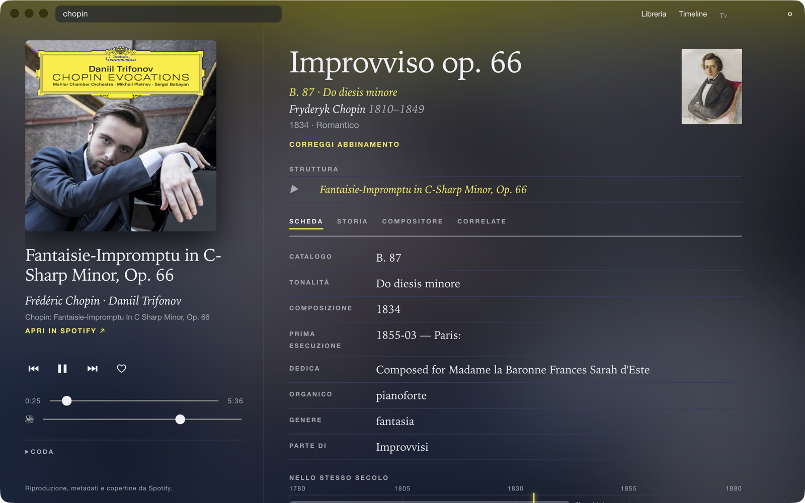
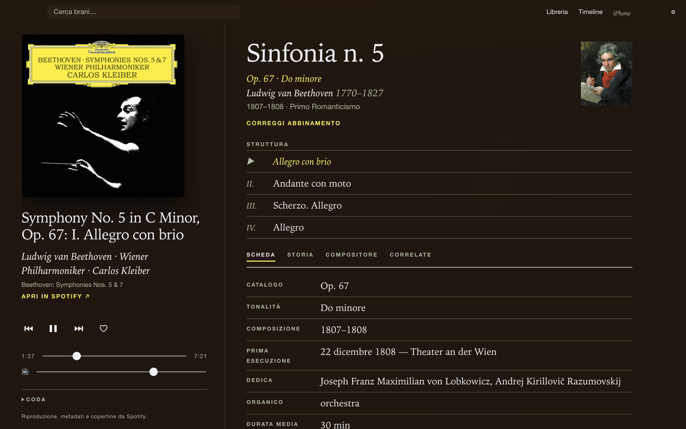
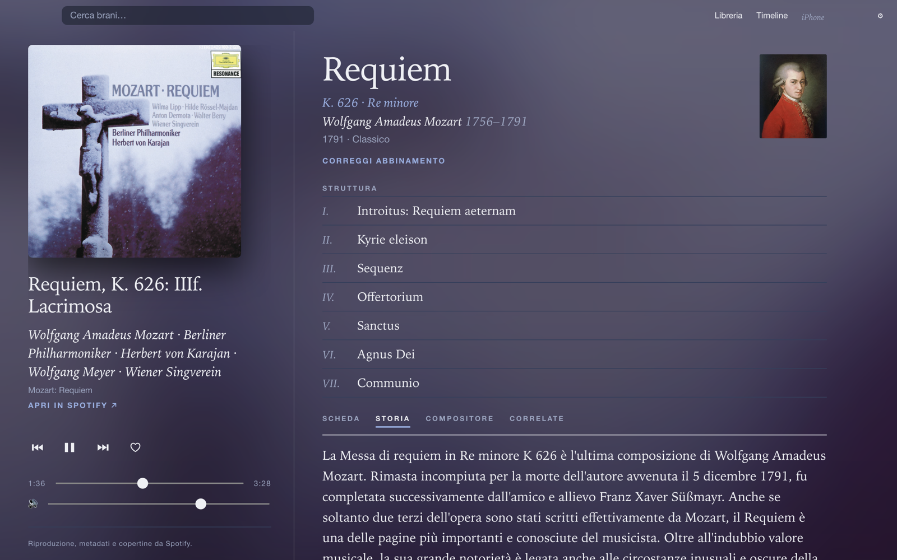
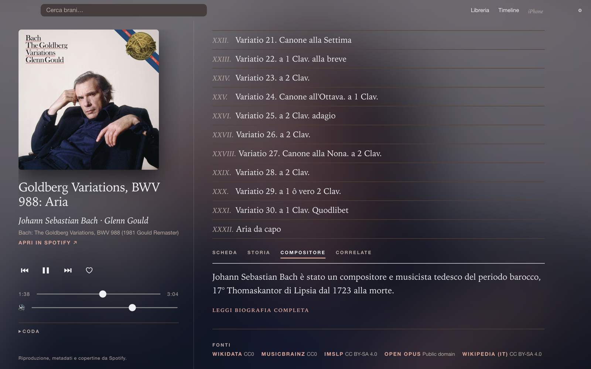
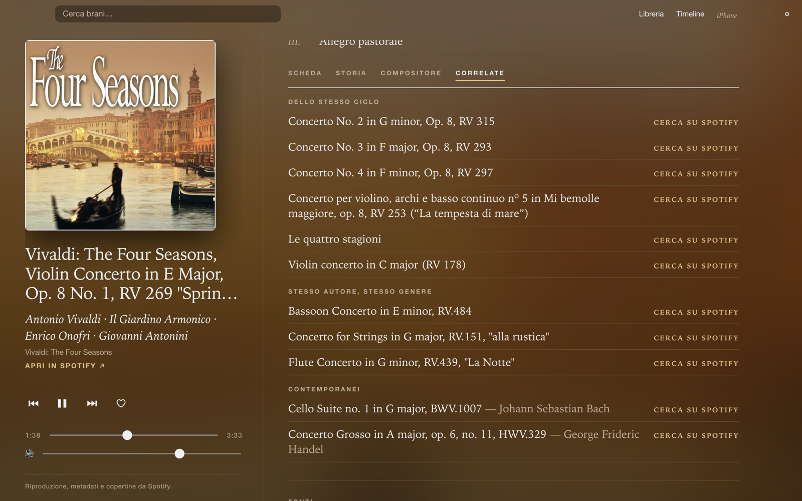
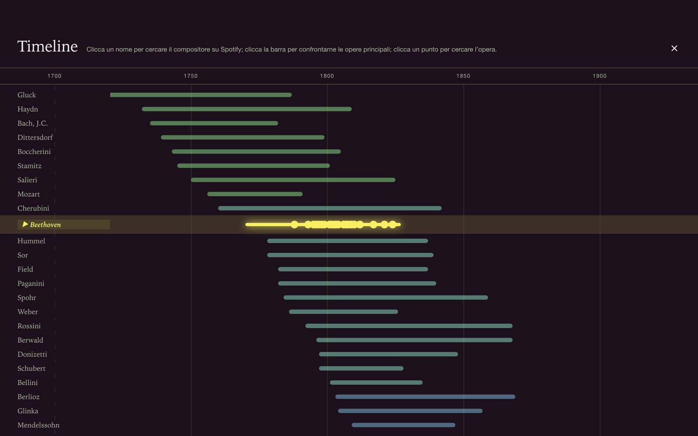

<h1 align="center">
  <br>
  Muti
</h1>

<p align="center">
  <em>Player desktop per la musica classica: ascolti da Spotify, leggi l'opera.</em>
</p>

<p align="center">
  
</p>

Muti riproduce i brani da Spotify e, accanto alla traccia, mostra **cosa stai ascoltando davvero**: l'opera, i movimenti, la storia, il compositore e le opere correlate, presi da fonti aperte.

## Cosa fa

- **Scheda dell'opera**: catalogo, tonalità, anno, prima esecuzione, dedica, organico, genere.
- **Struttura**: elenco dei movimenti, con quello in ascolto evidenziato.
- **Storia e compositore**: testi da Wikipedia (italiano, con fallback all'inglese segnalato), ritratto, date, epoca.
- **Correlate**: stesso ciclo, stesso genere, arrangiamenti, contemporanei.
- **Timeline**: compositori e opere disposti nel tempo.
- **Partitura**: link IMSLP quando disponibile.
- **Correggi abbinamento**: se il matching sbaglia, scegli tu l'opera giusta. La scelta viene ricordata.

Il riconoscimento brano → opera è deterministico (titolo, numero di catalogo, compositore tra gli artisti). Nessun modello AI tocca i contenuti Spotify.

## Screenshot

| | |
|---|---|
|  |  |
| **Scheda**: Beethoven, Sinfonia n. 5 (Kleiber) | **Storia**: Mozart, Requiem K. 626 (Karajan) |
|  |  |
| **Compositore**: Bach, Variazioni Goldberg (Gould) | **Correlate**: Vivaldi, La Primavera (Il Giardino Armonico) |


<p align="center"><sub><b>Timeline</b>: compositori dal Rinascimento al Novecento, con le opere principali del compositore in ascolto.</sub></p>

I colori dell'interfaccia derivano dalla copertina del disco in ascolto.

## Fonti

[Wikidata](https://www.wikidata.org) (hub) · [Wikipedia](https://www.wikipedia.org) · [MusicBrainz](https://musicbrainz.org) · [Open Opus](https://openopus.org) · [IMSLP](https://imslp.org)

Le chiamate partono dal main process, con User-Agent identificativo e cache su disco.

## Requisiti

- Account **Spotify Premium**
- Una tua app su [developer.spotify.com](https://developer.spotify.com/dashboard) (Spotify in Development Mode limita ogni Client ID a 5 utenti, quindi ognuno usa il proprio)
- Node.js 22+

## Avvio

```sh
npm install
npm run dev
```

Al primo avvio:

1. Crea un'app su developer.spotify.com con redirect URI `http://127.0.0.1/callback`.
2. Incolla il **Client ID** in Muti.
3. Inserisci un contatto (email o URL), richiesto da Wikimedia e MusicBrainz.

Riproduzione integrata nell'app oppure via **Spotify Connect** (tieni aperta l'app Spotify su un dispositivo).

## Script

| Comando | |
|---|---|
| `npm run dev` | sviluppo con hot reload |
| `npm test` | test di parsing e risoluzione, offline (HTTP registrato in `test/fixtures`) |
| `npm run typecheck` | controllo tipi main + renderer |
| `npm run dist` | build e pacchetto con electron-builder (dmg / nsis / AppImage) |

## Stack

Electron · React 19 · TypeScript · electron-vite

Dettagli di architettura, vincoli Spotify e roadmap in [SPEC.md](SPEC.md).

## Prima del rilascio

- Logo e attribuzione Spotify ufficiali
- Notarizzazione macOS

---

<sub>Riproduzione, metadati e copertine da Spotify. Muti non è affiliato né approvato da Spotify.</sub>
